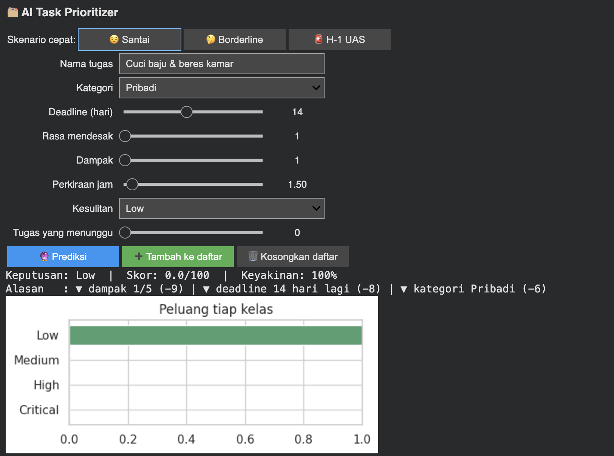
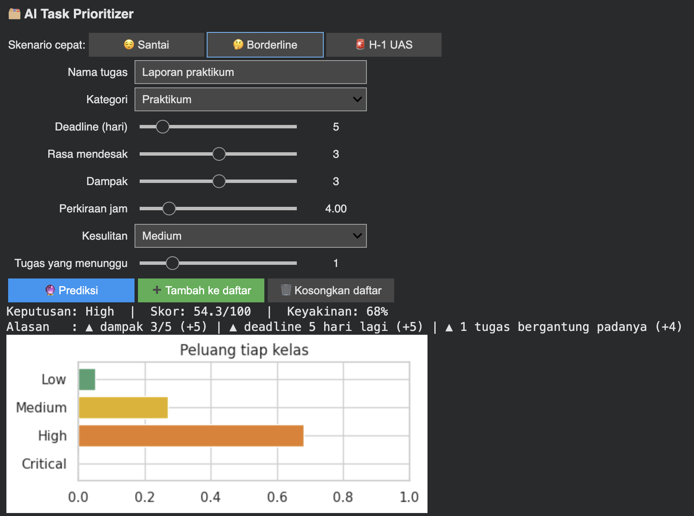
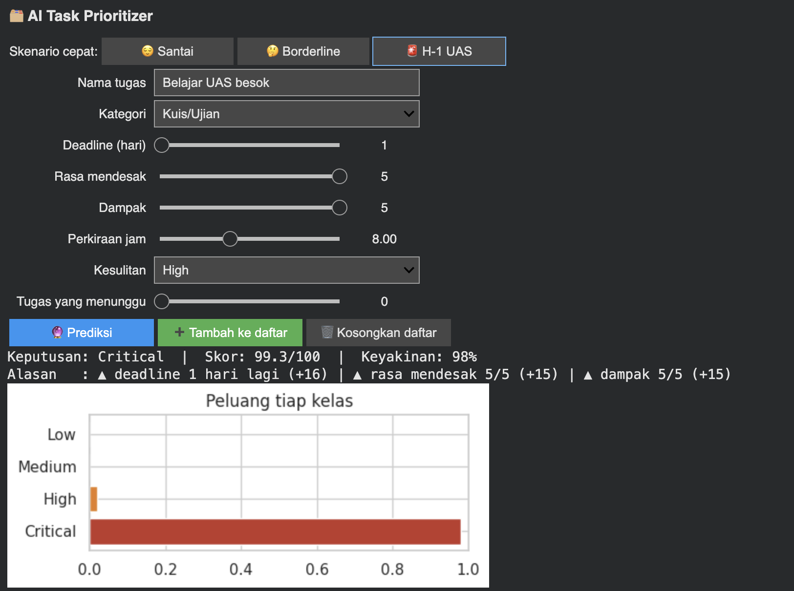

# AI Task Prioritizer

**Which task should I do first?** A Random Forest model that predicts a task's priority (Low / Medium / High / Critical), gives it a 0–100 score so a to-do list can be ranked, and explains each decision with SHAP, wrapped in an interactive `ipywidgets` form.

[](https://colab.research.google.com/github/wisnujayaa/ai-task-prioritizer/blob/main/AI_Task_Prioritizer.ipynb)

Mini project for *Pelatihan Elektrifikasi 2026* (DigitalSkola). The notebook's narrative is written in Indonesian; this README is in English.

## Why synthetic data?

The 200 tasks are generated, and their priority comes from a **hidden rule**: time pressure 40%, impact 30%, urgency 15%, dependencies 15%, plus label noise. The model never sees the rule. Because the answer key exists, two things that are usually unverifiable become checkable:

- whether data cleaning restored the true values (the raw file is deliberately dirty: empty cells, duplicate rows, inconsistent spellings, impossible values);
- whether the model's SHAP explanations point at the factors that actually drive the labels.

## Results

Mean accuracy over 50 data splits (5×10 repeated stratified cross-validation):

| Model | Accuracy |
|---|---|
| Always guess Low (baseline) | 0.38 |
| Simple rule | 0.59 |
| Single decision tree | 0.66 |
| **Random Forest (main model)** | **0.73** |
| Logistic Regression | 0.85 |

- **Logistic Regression wins**, and the notebook explains why: the labelling rule is a weighted sum, a shape that suits a linear model. Random Forest is kept as the main model for the explanation and decision-layer work.
- **SHAP check against the true rule:** time pressure and impact come out as the two largest factors, matching the rule. Urgency is slightly overstated, and roughly 12% of influence goes to category and difficulty, which are not in the rule (the model uses them as proxies).
- **Cost-sensitive decision layer:** underestimating an urgent task is penalised 2× more than overestimating. This cut "under-prioritized" cases from 19% to 9%, at the price of more over-prioritizing. It is a deliberate trade-off.
- **Leakage experiment:** selecting features *before* splitting the data gave 0.49 accuracy on purely random data (a majority-class guess scores 0.375). Doing it correctly inside the pipeline gave 0.26.

## Demo

Three scenarios through the interactive form:

| Relaxed | Borderline | Day before exam |
|---|---|---|
|  |  |  |
| Low · score 0.0 · confidence 100% | High · score 54.3 · confidence 68% | Critical · score 99.3 · confidence 98% |

## Run it

The easiest way is the Colab badge above (*Runtime → Run all*).

Locally:

```bash
pip install -r requirements.txt
jupyter lab AI_Task_Prioritizer.ipynb
```

The notebook regenerates the data from a fixed seed. The generated files are also included:

| File | What it is |
|---|---|
| `AI_Task_Prioritizer.ipynb` | Full analysis, model, SHAP and the interactive form |
| `generate_dataset.py` | Synthetic data generator (fixed seed) |
| `tugas_kuliah_dataset_raw.csv` | Dirty data, as the model pipeline receives it |
| `tugas_kuliah_dataset_clean.csv` | Cleaned data |

## Limitations

- The data is synthetic and small (200 tasks). Results describe how methods behave when the true rule is known, not how real students prioritise.
- SHAP explains the **model**, not necessarily the real world.
- Label noise is part of the design, so accuracy has a ceiling below 1.0.

## Transparency: AI assistance

This project was built with AI assistance (Claude, Anthropic). I directed the work according to the brief, ran the whole notebook, reviewed the results, and studied the key decisions (leakage, cost-sensitive scoring, validating SHAP against the known rule). I am still working through some implementation details.

## License

MIT, see [LICENSE](LICENSE).
